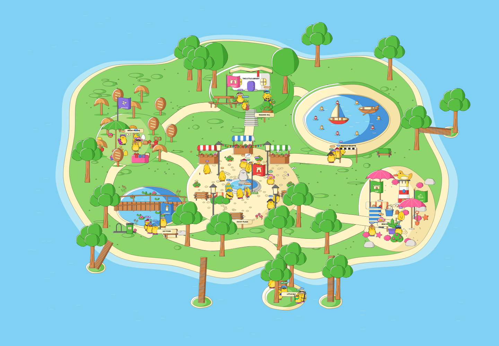

# Ducky Land integrated build

All eight sessions have a REPORT.md and their usable parts are merged. Finalised 2026-10-29 23:42 IST, within the 2.5-hour limit. This is a local prototype, ready for browser review. Real headless-browser verification remains blocked by this environment.

## Play and run

**http://127.0.0.1:8800/**

Both servers have been left running. If restarting, use two terminals from this folder:

```sh
python3 serve.py
```

```sh
node server.mjs
```

The page uses Python's http.server on loopback port 8800 with no-store headers. Multiplayer uses ws://127.0.0.1:8810/room. Its health endpoint is http://127.0.0.1:8810/health. Both bind only to 127.0.0.1.

Join with a name, city and Drip outfit. Tap paths to walk, or use WASD/arrows. Drag for the floating joystick. Double tap your Ducky, hold on the world, or press Escape for emotes, sound, wardrobe and photo mode. Q quacks, E toggles dance, 1 through 7 select the life session's emotes, M mutes, and P opens photo mode. Bread Hunt starts in Bread Woods; Duck Race starts at the lake finish gate. There is no persistent world HUD or action bar.

## Merged sessions

| Session | Status | Integrated behavior |
| --- | --- | --- |
| [World](../codex-world/REPORT.md) | Done, merged | 5800 x 4400 island, seven zones, all five connected islets, collision/pathfinding, camera follow and exact foot-y sorting |
| [Assets](../codex-assets/REPORT.md) | Done, merged | All 203 final SVGs converted to native Rive, 43 scenery replacements and 56 additional small props. Remaining assets stay available as native artboards |
| [Crowd](../codex-crowd/REPORT.md) | Done, merged | Twelve social plaza NPCs use the actual island furniture, seat reservations, stalls, greetings, followers, parties and native sit/look/preen/sleep poses |
| [Life](../codex-life/REPORT.md) | Done, merged | Native birds, butterflies, leaves and fountain splashes; seven emotes and four original local WAVs |
| [Activities](../codex-activities/REPORT.md) | Done, merged | Twelve-slice forest hunt, +10 native pops, persistent local scoring, eight-duck AI race, native floats/wakes/splashes, countdown, full results and replay |
| [Onboard](../codex-onboard/REPORT.md) | Done, merged | 33 permitted items, nine cities, URL presets, randomize, isolated native landing, frozen 1600 x 900 and 1200 x 1200 postcards and copyable outfit link |
| [Mobile](../codex-mobile/REPORT.md) | Done, merged | Floating proportional joystick, pointer ownership and resets, responsive camera, full DPR normally, reduced resolution/render count on constrained devices or sustained slow frames |
| [Multiplayer](../codex-multiplayer/REPORT.md) | Done, merged | Up to 16 real players, 12 Hz authoritative snapshots, local prediction, 100 ms remote histories, identity/outfit sync, all emotes, shared social crowd and city quacks |

No session is missing or stuck. Other folders and the original 8793 server were left unchanged. No messages were sent to the other sessions.

## Canonical Ducky and build

The Ducky was pulled from **../rive/gen.py** at **2026-10-29T23:37:26.741228+05:30**, including morph.py and the official eight-view SVG dependencies. The source snapshot was last modified at 2026-10-29T23:35:01.844540+05:30. No lane's copied Ducky was used. The main morph/turn geometry and layers remain authoritative. Separate compatibility layers add canonical Drip outfits, life/crowd poses and onboarding's native arrival wrapper. The main rig's shadow-free appearance is retained.

Canonical source SHA-256: `b5f8a911fa1e4c2cb1263cb9dbd15b5aac28ddf93369632f187e8a133127cb77`.

The runtime has **one Ducky artboard**, 303 total native artboards, 203 native SVG assets, and no scripts. Acc 6 is not imported. World and UI artwork use the shared Drip kit, native vectors, flat side shading and white highlights. HTML supplies accessible join/menu/download controls; Canvas 2D only composites the native photo exports.

Final unsigned runtime: `rive/web/ducky-land.riv`, **5,358,580 bytes**.

Runtime SHA-256: `59b5733d10f2ea7e4493986e71262f03476717671a731268d26ea28ea0baabcd`.

Rebuild from the accepted snapshots, automatically refreshing the canonical rig:

```sh
/opt/homebrew/bin/python3.14 build.py
```

Collect new lane deliveries first with `build.py --sync`. To refresh only the separately evolving main rig and verify/rebuild it:

```sh
/opt/homebrew/bin/python3.14 pull_rig.py
```

The build requires the installed Rive CLI and source SVG converter at `/Users/pragadees.xd/Developer/hallow-os/tools/svg2rml.py`. Runtime playback is self-contained and uses only local JS, WASM, fonts and audio.

## Verification

- `rive rive --verify`: **0 errors, 0 warnings**. [Build check](qa/verify.log)
- `rive inspect rive --summary`: **problems: []**. [Inspection](qa/inspect.json)
- **3 real socket tests passed**, covering two clients, movement/turns, server identity and outfits, emotes, deduplicated city quacks, invalid positions, social decisions and departures. [Results](qa/network-results.log)
- The actual integrated host runs against official Rive Canvas2D WASM with a Skia software canvas. It renders two identities from the real socket server, exercises WASD/camera, joystick second-finger ownership/release/cancel, walks to every bread slice through actual island routes, completes all eight race finishes, and exports both native postcards. [Software results](qa/software-results.json)
- Served runtime bytes match disk exactly, no-store is present, required local files return 200, all eight reports exist, one Ducky artboard is present, and no forbidden accessory or scripts are imported. [Acceptance record](qa/acceptance.json)

Repeat checks with the servers running:

```sh
npm test
npm run test:software
npm run test:browser
```

**The final command is blocked here.** Headless Chromium/Chrome abort before opening a page with macOS Mach-port permission errors or SIGABRT. The browser connector is unavailable. Rive CLI screenshots fail because Metal is unavailable. [Full browser failure](qa/browser-blocked.txt), [graphics limits](qa/graphics-blocked.txt).

The integrated screenshots below are genuine native Rive software renders, opened and inspected by eye. They are not Chrome screenshots. Upstream lane reports include their own browser evidence, which is separate from integrated verification.

## Screenshots

[Open the complete native-render gallery](shots/gallery.html).



| Zone | Capture |
| --- | --- |
| Plaza | [Plaza](shots/software-plaza.png) |
| Lily Pond | [Pond and bridge](shots/software-pond.png) |
| Bread Woods | [Forest](shots/software-bread-forest.png) |
| Reading Hill | [Library](shots/software-library.png) |
| Race lake | [Lake](shots/software-race-lake.png) |
| Lighthouse beach | [Beach](shots/software-lighthouse-beach.png) |
| Islets | [Little Isle](shots/software-islets.png) |

| Feature | Capture |
| --- | --- |
| Join's native Ducky preview | [Preview](shots/software-join-preview.png) |
| Native arrival | [Landing](shots/software-landing.png) |
| Two real socket identities | [Multiplayer](shots/software-multiplayer.png) |
| Bread hunt, pop and result | [Playing](shots/software-bread-playing.png), [pop](shots/software-bread-pop.png), [result](shots/software-bread-complete.png) |
| Race countdown, floats and result | [Countdown](shots/software-race-countdown.png), [playing](shots/software-race-playing.png), [result](shots/software-race-complete.png) |
| Floating joystick | [Joystick](shots/software-joystick.png) |
| Phone/tablet views | [375](shots/software-viewport-375x812.png), [390](shots/software-viewport-390x844.png), [412](shots/software-viewport-412x915.png), [landscape](shots/software-viewport-844x390.png), [tablet](shots/software-viewport-768x1024.png) |
| Native photo exports | [1600 x 900](shots/software-photo-wide.png), [1200 x 1200](shots/software-photo-square.png) |
| Quack, heart, laugh, wave, sleep, angry, party | [Quack](shots/software-pose-2.png), [heart](shots/software-pose-4.png), [laugh](shots/software-pose-5.png), [wave](shots/software-pose-6.png), [sleep](shots/software-pose-7.png), [angry](shots/software-pose-8.png), [party](shots/software-pose-9.png) |
| Crowd sit, look and preen | [Sit](shots/software-pose-10.png), [look](shots/software-pose-11.png), [preen](shots/software-pose-12.png) |

The join form and photo-dialog browser page captures remain pending; their native preview and generated PNGs are included. Software events are simulated, so trusted phone touches, Safari/Firefox behavior and GPU performance are unverified. No 60 fps claim is made.

## Honest limits

1. Directional clothing artwork is absent from the main morph rig. The compatibility outfits fit front views; hats, shades and accessories withdraw on profile/back views. The main official turn geometry is preserved.
2. Race opponents remain local AI, fixed at eight participants in the integrated entry. Other real players see the player's shared world presence; the race is not a server-coordinated race room.
3. Scores and membership are a local prototype. City totals live in server memory; personal bread totals use localStorage. Restarting the server resets shared totals. Reconnect creates a fresh identity. There is no production authentication or durable storage.
4. The shared social brain controls twelve plaza NPCs; other zones use the world lane's simpler wandering residents. Crowded names and real players can overlap.
5. Browser/compositor/audio-device QA remains outstanding because of the documented sandbox restriction. The headless suite is provided and never falls back to a visible browser.

No Rive push, signing, publishing, deployment, paid service, account creation or public posting was performed. The only outgoing team update is the user-requested final log.

## Collection history

- 22:40 IST: canonical baseline copied; all eight lanes active, reports missing.
- 22:54 IST: island and native rig/pose build merged; feature adapters connected.
- 23:06 IST: five reports available; 203-asset native library and software rendering working.
- 23:18 IST: all eight reports available; final onboarding and activity details merged.
- Finalisation: canonical rig pulled again, native/socket/software acceptance completed, and browser blocker recorded. STATUS.md and REPORT.md contain the same final handoff.
